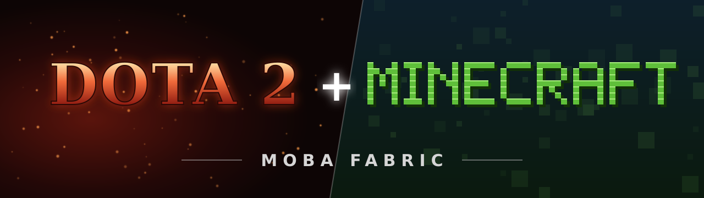

  

  <b>Dota 2 heroes, gold and runes, inside Minecraft.</b> 
  A MOBA-style mod for Minecraft Java Edition, built with Fabric.

  
  
  
  
  

  <a href="#about">About</a>
  &nbsp;·&nbsp;
  <a href="#the-games-behind-it">The games behind it</a>
  &nbsp;·&nbsp;
  <a href="#about-me">About me</a>
  &nbsp;·&nbsp;
  <a href="#license">License</a>

---

## About

**MOBA Fabric** brings the feel of Dota 2 into Minecraft. Instead of playing as yourself, you watch the battlefield from above as a spectator and command a hero, just like in Dota 2.

<table>
  <tr>
    <td align="center" width="33%">
      <h3>👁️</h3>
      <b>Spectator view</b> 
      Watch the battlefield from above
    </td>
    <td align="center" width="33%">
      <h3>⚔️</h3>
      <b>Command a hero</b> 
      HP and mana bars over its head
    </td>
    <td align="center" width="33%">
      <h3>💰</h3>
      <b>Gold and runes</b> 
      Last hits, passive gold, power-ups
    </td>
  </tr>
</table>

> [!NOTE]
> The mod is in early development. The features above are the goal; not all of them are in the game yet.

## The games behind it

| | Game | Made by |
|:-:|---|---|
| 🛡️ | [**Dota 2**](https://www.dota2.com) | [Valve](https://www.valvesoftware.com) |
| ⛏️ | [**Minecraft**](https://www.minecraft.net) | [Mojang Studios](https://www.minecraft.net) |
| 🧵 | [**Fabric**](https://fabricmc.net) | [FabricMC](https://github.com/FabricMC), the modding toolchain this mod is built with |

## About me

I'm a **solo developer** with almost no GitHub experience, and this is one of my first projects here. I'm learning modding, Java and GitHub as I go, so mistakes are expected.

Ideas, bug reports and advice are welcome in [**Issues**](https://github.com/cl1nchi/moba-fabric/issues).

## Screenshots

<i>Coming soon.</i>

## License

The code is released under the [MIT License](LICENSE).

---

  
    Unofficial fan project. Not affiliated with or endorsed by Valve Corporation or Mojang Studios. 
    Dota 2 is a trademark of Valve Corporation. Minecraft is a trademark of Mojang Studios.
  

